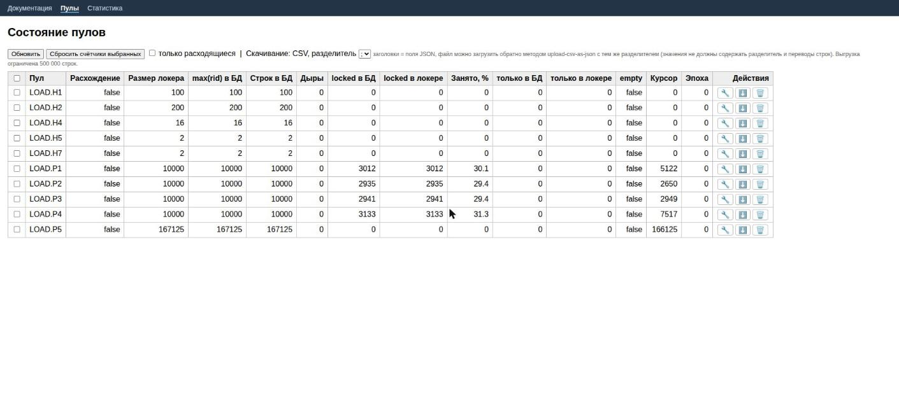
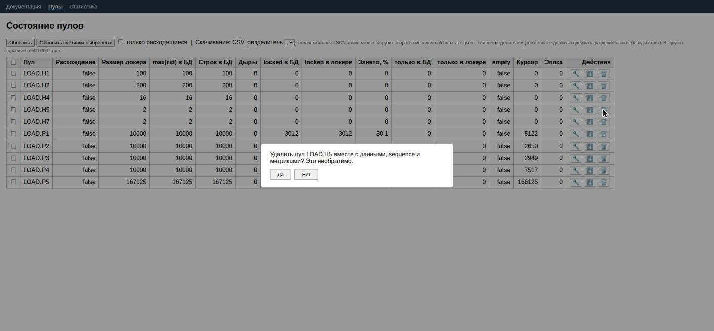

# Что нового в datapool 3.x

Кратко о том, что появилось начиная с версии 1.8.0 (текущая — **3.1.1**). Полный список изменений: [changelog.md](../changelog.md). Результаты нагрузочных тестов: [load-test-3.1.md](load-test-3.1.md).

| | |
|---|---|
| 🛠 [Страница «Пулы»](#страница-пулы) | состояние, починка счётчика, скачать, удалить |
| 📈 [Страница «Статистика»](#страница-статистика) | RPS, RTT, ошибки, остаток пула, зацикливания |
| 🤖 [MCP для ИИ-агентов](#mcp-для-ии-агентов) | обслуживание пулов из чата, с защитой от перегрузки |
| 📜 [OpenAPI 3.0](#openapi-30) | описание всех ручек |
| 🔒 [Надёжность выдачи](#надёжность-выдачи) | нет дублей блокировок и бесконечных циклов |
| 🧱 [Структура кода и проверки](#структура-кода-и-проверки) | слои, 118 тестов, защита структуры БД |

Меню наверху каждой страницы: **Документация · Пулы · Статистика**.

---

## Страница «Пулы»

`http://localhost:8080/pools.html`: таблица всех пулов. Расходящиеся (кэш приложения не совпадает с БД) идут первыми и подсвечены красным.



- **Заголовки с подсказками:** наведите курсор на название столбца. Например, **«Дыры»** — это `max(rid)` минус число строк: номера, под которыми в таблице нет строки (упавшая вставка, удалённая строка). Не ошибка, читатель их пропускает.
- **«Занято, %»** — доля занятых строк (`locked в локере / размер локера`).
- **Сортировка** по любому столбцу, фильтр «только расходящиеся».
- В каждой строке справа три кнопки-иконки:
  - 🔧 **сбросить счётчик**: пересобирает кэш из БД и ставит курсор на первую свободную строку (схема БД не меняется);
  - ⬇️ **скачать** пул в CSV: тот же `GET /api/v1/download/csv`, разделитель `;` или `,` выбирается сверху; файл можно загрузить обратно методом `upload-csv-as-json` с тем же разделителем;
  - 🗑 **удалить** пул целиком: тот же `DELETE /api/v1/drop-pool`, перед удалением спрашивает подтверждение.



- Одна массовая операция: **«Сбросить счётчики выбранных»** (отметьте чекбоксы).

REST: `GET /api/v1/pools`, `POST /api/v1/pools/repair`, `POST /api/v1/pools/repair-batch`.

## Страница «Статистика»

`http://localhost:8080/statistics.html`: последний час по данным самого сервиса (Prometheus для этой страницы не нужен).


1. **RPS** по пулам и пунктирная линия **«Итого»** (выключается галочкой).
2. **Время ответа (RTT сервиса)**, мс, среднее за интервал.
3. **Ошибки в секунду.**
4. **Остаток пула, %**; галочка «показать занятое» переключает на долю занятых.
5. **Частота зацикливаний**: сколько раз в секунду `get-next-value` наткнулся на занятую или отсутствующую строку и сдвинул курсор.
6. **Сводная таблица:** средний, последний и максимальный RPS, время ответа и количество «вредных» циклов (лимит попыток исчерпан, данные не найдены); значение больше 0 подсвечивается красным.


- Фильтр сверху: любое число пулов (мультивыбор), выбор запоминается в браузере.
- Лёгкая: чистые SVG и JavaScript, без библиотек; браузер обращается к серверу **не чаще раза в 15 секунд**, в том числе после перезагрузки вкладки.
- Сервис раз в 15 секунд снимает счётчики и хранит час в памяти (после перезапуска история пуста). В горячий путь выдачи ничего не добавлено.
- Данные: `GET /api/v1/statistics`; новая метрика Prometheus `datapool_get_next_retries`.

## MCP для ИИ-агентов

`POST http://localhost:8080/mcp`: сервер MCP (Streamable HTTP, JSON-RPC 2.0), отдельный контроллер на Java; под капотом те же сервисы, что у REST.

| Тула | Что делает |
|---|---|
| `about` | как устроен датапул, как искать проблемы, как не испортить идущие тесты (читать первой) |
| `list_pools`, `counters_stats` | таблица пулов и статистика по сломанным счётчикам |
| `repair_pools`, `reset_sequence`, `unlock` | починка и сброс |
| `put_value`, `upload_csv`, `download_pool_csv`, `drop_pool` | данные: вставка, загрузка, выгрузка, удаление |

`get-next-value` и `search-by-key` в MCP **намеренно нет**: это горячий путь нагрузки, он берёт и блокирует тестовые данные.

Защита от агентов: имена проверяются, не больше 30 вызовов тул в минуту, тяжёлые операции по одной (`busy`), выгрузка не более 5 000 строк, удаление требует `confirm=ENV.POOL`.

```bash
curl -s -X POST http://localhost:8080/mcp -H 'Content-Type: application/json' \
  -d '{"jsonrpc":"2.0","id":1,"method":"tools/call","params":{"name":"counters_stats","arguments":{}}}'
```

## OpenAPI 3.0

[api-specification/openapi.yaml](../api-specification/openapi.yaml): все ручки, включая `/mcp` и `/api/v1/statistics`. Тест сверяет спецификацию с реальными эндпоинтами: добавили ручку и не описали, сборка упадёт.

## Надёжность выдачи

Исправлено в 1.8.0 (результаты: [load-test-3.1.md](load-test-3.1.md)):

- **Нет дублей блокировок:** строка занимается одним атомарным `UPDATE … WHERE locked = false` (на 1.7.8 было 178 дублей на 145 тыс. блокировок).
- **Нет бесконечных циклов:** поиск следующей свободной строки идёт строго вперёд, рекурсия заменена циклом с лимитом попыток (`datapool.getNext.maxRetries`, 1000). Дыра в rid от упавшей вставки больше не приводит к `StackOverflowError`.
- Курсор сдвигает один поток за раз, запоздавшие потоки его не откатывают.
- Работает и при **~30 % занятых строк** в нескольких пулах под нагрузкой до 4500 RPS.

Безопасность: имена `env` и `pool` проверяются во всех методах REST (раньше попадали в SQL как есть).

## Структура кода и проверки

```
todo/rest, mcp   контроллеры: параметры, вызов сервиса, метрики запроса
service          сценарии (PoolService, CsvExportService, PoolDiagnosticsService, StatisticsService), кэш блокировок
repository       PoolRepository: весь SQL и DDL
```

- **Структура БД не менялась** (таблица `ENV.POOL`: `rid`, `text`, `searchkey`, `locked`; индексы `_rid`, `_lc`, `_sk`; sequence `SEQ_<POOL>_RID`, `_MAX`): существующая БД стартует с новым jar без миграции. Тест `DbStructureTest` сверяет DDL нового пула с эталоном.
- **118 тестов:** REST, MCP, сервисы на моках, имена, структура БД, спецификация, пулы с 30 % занятых строк.
- **Gatling-регрессия** в [tests/load](../tests/load/README.md): вердикт `PASS`/`FAIL` по дублям, ошибкам обхода, расхождениям и вредным циклам.
- Jar в [bin/](../bin/) самодостаточный (все зависимости внутри): запускается `java -jar` без Maven и без сети.
