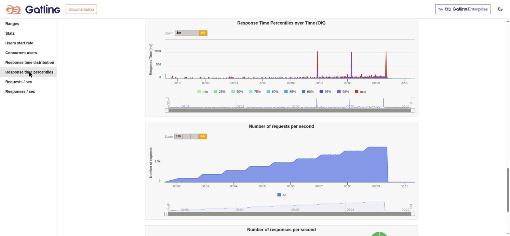
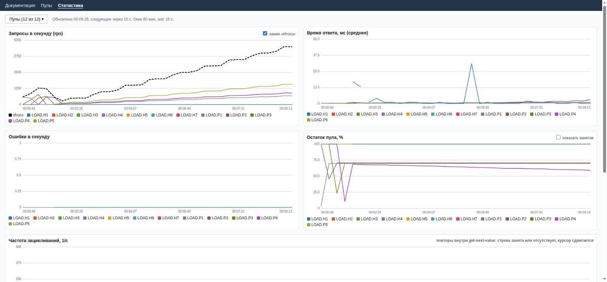
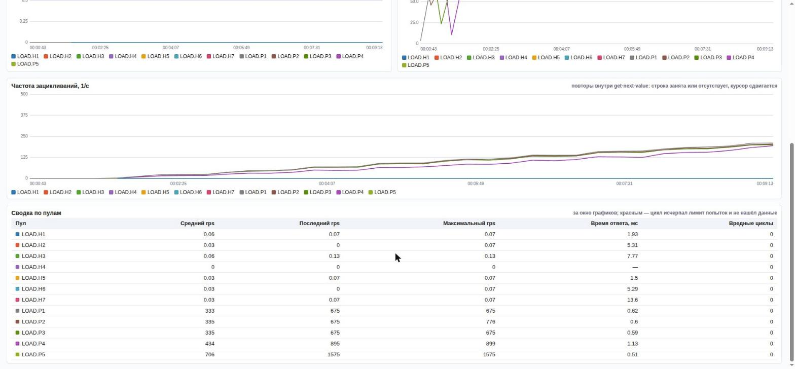

# Нагрузочное тестирование datapool 3.1.1

> **Коротко.** Лестница от **500 до 4500 RPS** (по 40 секунд на ступень), 1 107 916 запросов, **ошибок 0**, дублей блокировок **0**, бесконечных («вредных») зацикливаний **0**, расхождений кэша и БД после теста нет. В пулах `p1…p4` при этом заранее и навсегда занято **около 30 %** строк.
> Медианный RTT **1 мс**, 95-й перцентиль **3 мс**, 99-й **35 мс**. Есть редкие выбросы до ~1 с (45 запросов из 1,1 млн), причина не установлена, см. [ограничения](#ограничения-и-что-не-проверено).

| Показатель | Значение |
|---|---|
| Запросов всего | 1 107 916 (OK 100 %, KO 0) |
| RPS: средний за прогон / последняя ступень | 2 094 / ≈ 4 500 |
| RTT клиента, мс | min 0 · p50 **1** · p75 1 · p95 **3** · p99 **35** · max 1 053 · mean 2 |
| Запросов медленнее 800 мс | 45 (0,004 %) |
| Дублей блокировки (p4, 113 883 блокировок) | **0** |
| «Вредных» циклов (лимит попыток исчерпан) | **0** |
| Ошибок и исключений в логе сервиса | 0 |
| Вердикт Gatling | **PASS** |

RPS в статье — запросов в секунду, RTT — время ответа, измеренное клиентом (Gatling): от отправки запроса до получения ответа.

## Стенд

| | |
|---|---|
| Машина | ноутбук AMD Ryzen 5 3550H (8 потоков), 13 ГБ ОЗУ, Linux 6.14 |
| Сервис | datapool 3.1.1, Java 8 (Temurin 1.8.0_504), `-Xms1g -Xmx2g`, встроенный Tomcat (100 потоков, 10 000 соединений) |
| БД | H2 1.4.197, файловая, `LOG=0;UNDO_LOG=0;LOCK_MODE=3;WRITE_DELAY=3000;CACHE_SIZE=512000` |
| Генератор | Gatling 3.14.3 (Java 17), **на той же машине**, общий пул соединений (keep-alive) |

Генератор и сервис делят одни и те же 8 потоков процессора, поэтому цифры консервативны: на отдельной машине генератора потолок будет выше.

## Профиль нагрузки

Сценарий `tests/load` → `datapool.DatapoolSimulation`, пять пулов: `p1…p4` по 10 000 строк, `p5` стартует с 1 000 и растёт вставками. Доли считаются от общего RPS:

| Ручка | Доля RPS | Что делает |
|---|---|---|
| `get-next-value` p1, p2, p3 | по 15 % | чтение по кругу без блокировки |
| `get-next-value?locked=true` + `unlock` p4 | 20 % (2 запроса на итерацию) | берёт строку, держит 0,2–1,7 с, освобождает; 3 % «долгих» блокировок по 20–60 с |
| `put-value` p5 | 15 % | вставка строки с ключом поиска |
| `get-next-value` p5 | 15 % | чтение пула, который растёт |
| `search-by-key` p5 | 5 % | поиск по ключу только что вставленных строк |

- **Профиль RPS:** прогрев 30 с, затем 9 ступеней по 40 с (между ними разгон 5 с): 500 → 1000 → … → **4500 RPS**.
- **30 % занятых строк:** перед тестом в каждом из пулов `p1…p4` через API занято и оставлено навсегда ~30 % строк (3 012, 2 935, 2 941 и 3 133 из 10 000). Курсору приходится постоянно обходить занятые строки: это самый неприятный для выдачи режим.
- **Редкие ручки для людей и ИИ:** каждый из 26 редких запросов (страницы, диагностика, починка, выгрузка и загрузка, удаление, статистика, 10 тул MCP) выполняется **по 2 раза в минуту** на служебных пулах `h1…h7`, ровно по 16 раз за прогон. Они нужны, чтобы убедиться: обслуживание под нагрузкой ничего не ломает.

Параметры запуска:

```bash
mvn gatling:test -Dgatling.simulationClass=datapool.DatapoolSimulation \
    -Drps=500 -Dstep=500 -Dsteps=9 -DlevelSec=40 -DsearchW=0.05 \
    -DhumanPerMin=2 -DaiPerMin=2 -DpreLockPools=p1,p2,p3,p4 -DpreLockPct=30
```

## Результаты

### RPS и RTT во времени (отчёт Gatling)



Верхний график — перцентили RTT во времени, нижний — запросы в секунду: ровные ступени до 4500 RPS. Полный отчёт Gatling (HTML) весит ~50 МБ и в репозиторий не кладётся: его можно получить запуском выше, см. [tests/load](../tests/load/README.md).

### То же из страницы статистики сервиса





Страница `/statistics.html` строится из метрик самого сервиса (без Prometheus): RPS с общей линией, среднее время ответа на стороне сервиса, ошибки, остаток пула (у `p1…p4` держится около 70 %), частота зацикливаний и сводная таблица. Столбец «Вредные циклы» везде 0.

### RTT по ручкам (клиент, мс)

Нагрузочные ручки (за весь прогон):

| Ручка | Запросов | RPS (средн.) | p50 | p95 | p99 | max | mean |
|---|---:|---:|---:|---:|---:|---:|---:|
| **Все запросы** | 1 107 916 | 2 094 | 1 | 3 | 35 | 1 053 | 2 |
| `get-next-value` p1 | 166 125 | 314 | 1 | 3 | 33 | 1 052 | 2 |
| `get-next-value` p2 | 166 125 | 314 | 1 | 3 | 33 | 1 050 | 2 |
| `get-next-value` p3 | 166 125 | 314 | 1 | 3 | 33 | 1 053 | 2 |
| `get-next-value` p5 (растущий пул) | 166 125 | 314 | 1 | 3 | 32 | 1 052 | 1 |
| `get-next-value?locked=true` p4 | 110 750 | 209 | 1 | 5 | 62 | 1 050 | 3 |
| `unlock` p4 | 110 750 | 209 | 1 | 3 | 50 | 1 053 | 2 |
| `put-value` p5 | 166 125 | 314 | 1 | 3 | 32 | 1 053 | 2 |
| `search-by-key` p5 | 55 375 | 105 | 1 | 3 | 33 | 1 042 | 1 |

Редкие ручки (по 16 вызовов, 2 в минуту, под полной нагрузкой), RTT в мс: p95 / max (на 16 вызовах они почти совпадают):

| Для людей (REST) | RTT | MCP (тулы для ИИ) | RTT |
|---|---|---|---|
| `GET /api/v1/pools` | 113 / 113 | `list_pools` | 84 / 84 |
| `GET /metrics` | 60 / 60 | `counters_stats` | 90 / 90 |
| `GET /api/v1/statistics` | 8 / 8 | `repair_pools` | 10 / 10 |
| `GET /statistics.html` | 4 / 4 | `reset_sequence` | 5 / 5 |
| `POST /pools/repair` | 4 / 4 | `unlock` | 13 / 13 |
| `POST /pools/repair-batch` | 27 / 27 | `put_value` | 14 / 14 |
| `GET /download/csv` | 41 / 41 | `download_pool_csv` | 6 / 6 |
| `POST /upload-csv-as-json` | 44 / 44 | `upload_csv` | 36 / 36 |
| `POST /put-value` (создаёт пул) / `DELETE /drop-pool` | 48 / 48 · 52 / 52 | `drop_pool` | 15 / 15 |
| `POST /unlock` (unlock-all) | 34 / 34 | `initialize` · `tools/list` · `about` | 6 / 6 · 4 / 4 · 7 / 7 |

Самые «тяжёлые» из редких ручек — те, что читают все пулы целиком (`/api/v1/pools`, `list_pools`, `counters_stats`): ~50–110 мс при 4500 RPS. Для запроса раз в 30 секунд это приемлемо; в цикле их вызывать не стоит (MCP режет это лимитом 30 вызовов в минуту).

### RTT на стороне сервиса (метрики Prometheus, среднее за весь прогон)

| Пул / ручка | Запросов | RTT сервиса, мс |
|---|---:|---:|
| `get-next-value` p1 / p2 / p3 | ~183 000 каждый | 0,61–0,64 |
| `get-next-value?locked=true` p4 | 127 617 | 1,44 |
| `unlock` p4 | 117 617 | 0,85 |
| `get-next-value` p5 | 333 250 | 0,33 |
| `put-value` p5 | 166 125 | 0,56 |
| `search-by-key` p5 | 55 375 | 0,46 |

Серверный RTT меньше клиентского: клиентский включает сеть (loopback), очередь соединения и работу генератора на тех же ядрах. Счётчики включают подготовку пулов и итоговый обход, поэтому числа запросов больше, чем в таблице Gatling (например, у `get-next-value` p5 в них и тест, и обход после него).

## Зацикливания при 30 % занятых строк

Когда курсор попадает на занятую строку, поток находит следующую свободную, сдвигает курсор и пробует ещё раз (повтор, «зацикливание»). Это штатно.

- Частота повторов растёт вместе с нагрузкой: до **~200 в секунду на пул** на последней ступени (около 30 % RPS пула, что соответствует доле занятых строк).
- **Вредный цикл** — запрос, исчерпавший лимит попыток (`datapool.getNext.maxRetries`, 1000) и не нашедший данные. Такого за весь прогон не было ни разу (**0**), в сводной таблице статистики столбец «Вредные циклы» подсвечивается красным при значении больше нуля.
- Исчерпанный пул (все строки заняты) — не вредный цикл: сервис честно отвечает «пуст».
- Итоговый обход каждого пула после теста выдал **ровно** все свободные строки (6 988, 7 065, 7 059 и 6 867 для `p1…p4`), без пропусков и повторов.
- Цена занятых строк: у `p4` p95 RTT 5 мс против 3 мс у остальных; общий mean вырос с 1 до 2 мс, p99 с ~22 до 29–35 мс по сравнению с прогоном без занятых строк.

## История: что изменилось по версиям

| Версия | Прогон | Результат |
|---|---|---|
| 1.7.8 | 1000 → 4500 RPS, без поиска | ошибок 0, но **178 дублей блокировки** на 145 тыс. блокировок |
| 1.7.8 | с `search-by-key` 5 % | **коллапс уже около 500 RPS**, 32 % ошибок и таймаутов во всех пулах |
| 1.7.8 | дыра в rid от упавшей вставки | бесконечное зацикливание, штурм `ALTER SEQUENCE`, HTTP 500 `StackOverflowError` |
| 1.8.0 | 1000 → 4500 RPS | 0 ошибок, **0 дублей**, цикла нет |
| 1.8.0 | 500 → 4500 RPS, search 5 % | 1 107 494 запроса, 0 ошибок, p99 20 мс |
| 3.0.0 | то же после слоистого рефакторинга | 1 107 884 запроса, 0 ошибок, mean 1 мс, p99 22 мс |
| 3.1.1 | то же + **30 % занятых строк** в p1…p4 | 1 107 916 запросов, 0 ошибок, 0 вредных циклов, p99 35 мс |

## Ограничения и что не проверено

- **Выбросы до ~1 с.** На графике RTT три всплеска (~70 секунд друг от друга) до ~1 с; всего 45 запросов медленнее 800 мс. Причину я не устанавливал: подозрение на паузы сборки мусора JVM или сброс буфера H2 (`WRITE_DELAY=3000`), проверка не проводилась.
- **Потолок не измерялся.** Тест останавливается на 4500 RPS (цель проекта: 3500–5000). Коллапс около 7200 RPS наблюдался на версии 1.7.8; на 3.x предельная нагрузка не искалась.
- **Один хост.** Генератор и сервис на одном ноутбуке; на выделенных машинах результат будет другим (скорее лучше).
- **Прогон один.** Прогонов с такими параметрами на 3.x было несколько (1,107 млн запросов, 0 ошибок каждый раз, p99 от 20 до 35 мс в зависимости от занятости строк), но повторов одного и того же профиля с оценкой разброса нет.
- **Пулы по 10 000 строк** (`p5` до 167 тыс.). Для миллионов строк диагностика `/api/v1/pools` (читает все занятые rid каждого пула) на нагрузке не проверялась.
- Сравнение с 1.7.8 сделано на одном и том же стенде, но на более раннем профиле (шаг 60 с вместо 40 с).

## Как повторить

```bash
cd tests/load            # нужен JDK 17 и Maven
# сервис запущен на http://localhost:8080 (java -jar bin/datapool-service-3.1.1.jar)
mvn gatling:test -Dgatling.simulationClass=datapool.DatapoolSimulation \
    -Drps=500 -Dstep=500 -Dsteps=9 -DlevelSec=40 -DsearchW=0.05 \
    -DhumanPerMin=2 -DaiPerMin=2 -DpreLockPools=p1,p2,p3,p4 -DpreLockPct=30
```

В конце тест печатает `VERDICT: PASS` или `FAIL` (дубли блокировок, ошибки обхода пулов, расхождения кэша и БД, вредные циклы) и пишет сводку в `target/datapool-diag.txt`. Описание параметров: [tests/load/README.md](../tests/load/README.md).
